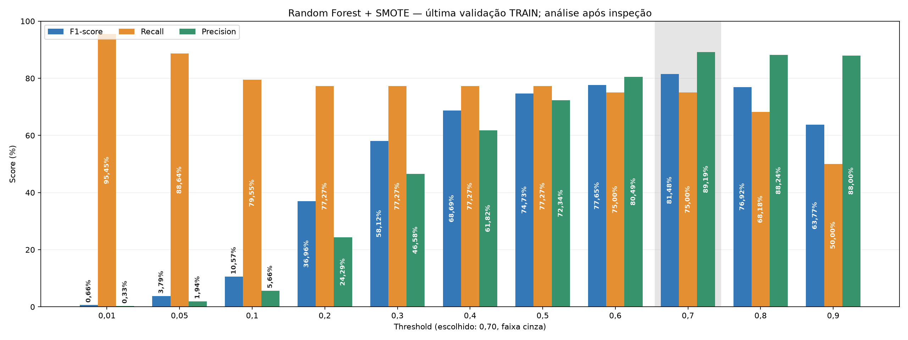
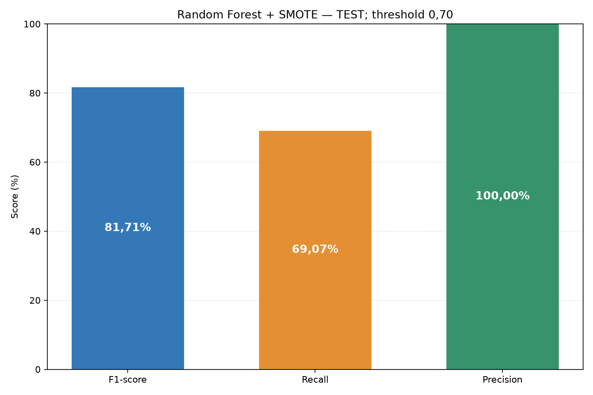

# Detecção de fraude — projeto reformulado

Este projeto é uma **reformulação do [Projeto-Deteccao-De-Fraude](https://github.com/Mateusssssssssss/Projeto-Deteccao-De-Fraude)**, criado no início da minha caminhada em Ciência de Dados e Machine Learning. A reformulação corrige o vazamento de dados causado pela aplicação de SMOTE e undersampling antes do split, organiza os experimentos e disponibiliza o modelo escolhido por uma API.

## Modelo escolhido — Random Forest + SMOTE

**Threshold: 0,70. Métrica principal: F1. Classe positiva: fraude (Class=1).**

O modelo foi escolhido a partir das análises de SMOTE isolado em [metricas_smotec.ipynb](notebooks/metricas_smotec.ipynb) e do diagnóstico em [model_select.ipynb](notebooks/model_select.ipynb). Na última validação temporal de TRAIN, apresentou **89,19% de Precision, 75,00% de Recall e 81,48% de F1**.

A escolha considera o equilíbrio entre detecção de fraudes e qualidade dos alertas, depois de comparar Random Forest e XGBoost com diferentes estratégias de balanceamento, padronização, seleção de features e thresholds. Ela corresponde à receita escolhida pelo autor; não representa o vencedor de todas as grades posteriores.

| Configuração | Valor |
|---|---|
| Estimador | RandomForestClassifier |
| n_estimators | 160 |
| max_depth | 14 |
| min_samples_leaf | 2 |
| max_features / criterion | sqrt / gini |
| class_weight | None |
| random_state | 42 |
| Pré-processamento | Imputação pela mediana + StandardScaler |
| Balanceamento | SMOTE, razão minoria/maioria 0,10; k_neighbors=3 |
| Threshold fixo | 0,70 |
| Features mantidas | 14 |

Features: V1, V2, V3, V4, V5, V7, V9, V10, V11, V12, V14, V16, V17 e V18.

O gráfico abaixo apresenta a sensibilidade do modelo aos thresholds na última validação TRAIN. A faixa cinza destaca 0,70.

A pasta [best_model/](best_model/) reúne o pipeline serializado, metadados, versões das dependências, exemplo de requisição e referência do registro no MLflow. O pacote utiliza o ajuste existente no TRAIN completo, com a mesma receita e features do modelo escolhido. Os 89,19% / 75,00% acima pertencem à validação do fold, não ao ajuste no TRAIN completo.

## Resultado no TEST — modelo escolhido

Avaliação de **73.434 transações**, com **97 fraudes** e **73.337 legítimas**, usando o pipeline congelado e threshold 0,70.

| Métrica | TEST |
|---|---:|
| Precision | 100,00% |
| Recall | 69,07% |
| F1 | 81,71% |
| Average Precision — AP/AUPRC | 0,7843 |
| Área trapezoidal PR | 0,7841 |
| ROC-AUC | 0,9734 |
| Balanced Accuracy | 84,54% |
| Especificidade | 100,00% |
| Acurácia | 99,96% |
| Log Loss | 0,007464 |
| Brier score | 0,000662 |
| TP — fraudes detectadas | 67 |
| FN — fraudes não detectadas | 30 |
| FP — legítimas alertadas | 0 |
| TN — legítimas liberadas | 73.337 |

O notebook [best_model_metrics.ipynb](notebooks/best_model_metrics.ipynb) contém todas as métricas com definições, relatório por classe, matriz de confusão, curvas PR/AUPRC e ROC, calibração, scores e erros por faixas/período. A validação aparece em seção própria.

### Potencial de melhoria e prioridade do Recall

**O modelo ainda pode ser aprimorado, principalmente na recuperação de fraudes.** No TEST apresentado, a Precision de 100% coexistiu com Recall de 69,07%: 30 das 97 fraudes não foram detectadas. Portanto, alta Precision, isoladamente, não caracteriza cobertura suficiente da classe positiva.

Na aplicação proposta, **o Recall tem maior prioridade operacional que a Precision quando o custo de uma fraude não detectada (falso negativo) supera o custo de investigar um alerta indevido (falso positivo)**. Essa assimetria deve orientar a decisão por meio do custo esperado dos erros, por exemplo, **C_FN × FN + C_FP × FP**, em que os custos podem variar conforme o valor da transação e a ação tomada. A Precision continua relevante para controlar o volume de revisão, os bloqueios indevidos e o atrito com clientes.

Uma evolução do projeto pode buscar **maximizar Recall sujeito a uma Precision mínima e à capacidade de análise de alertas**, com restrições definidas pelo negócio. A redução do threshold é uma alternativa a investigar, pois pode recuperar mais fraudes ao custo de mais falsos positivos. Esse ajuste e a comparação de novas estratégias devem ocorrer somente nas validações do TRAIN, com avaliação posterior em dados separados. O ganho precisa ser demonstrado; não é garantido pela alteração do limiar. A configuração atual permanece com **F1 como métrica principal e threshold 0,70**.

## Dados e protocolo

Base creditcard.csv: transações de cartão, Time, Amount, V1–V28 e target Class. Cada linha representa uma transação; a previsão considera as medidas disponíveis naquele momento. V1–V28 são componentes anonimizados fornecidos pela base, não features que esta API calcula a partir de uma transação bancária bruta.

- Arquivo original em data/raw/creditcard.csv, preservado e fora do Git.
- 284.807 linhas originais; 1.081 duplicatas exatas removidas de forma determinística.
- Separação temporal antes de aprender estatísticas: TRAIN com 210.292 linhas; TEST com 73.434.
- EDA que orienta modelagem, seleção de features, imputação, padronização, CV, resampling e threshold usam TRAIN.
- CV temporal mantém o treino anterior à validação e instantes empatados no mesmo lado.
- SMOTE e undersampling são ajustados somente no treino de cada fold, via pipeline imbalanced-learn.
- A regra solicitada remove uma feature apenas se ambas forem verdadeiras: |Pearson| < 0,090 e importância por permutação AP < 0,100.
- Na inferência, o pipeline aplica as transformações já ajustadas; não treina nem executa SMOTE.

As variáveis são numéricas. O nome do notebook metricas_smotec foi mantido, mas a técnica utilizada é **SMOTE**. SMOTENC é apropriado quando existem features categóricas e numéricas em conjunto.

## Comparações no TRAIN

Foram avaliados Random Forest e XGBoost, incluindo ausência de reamostragem, SMOTE isolado, undersampling isolado, combinação de under + SMOTE, dados com/sem padronização, ablação de features e ajuste de threshold. F2 e F3 foram explorados para dar maior peso a Recall; **F1 permanece a métrica principal atual**.

A tabela abaixo resume médias de CV temporal no TRAIN, sob **threshold comum de 0,50**. Ela não representa o threshold 0,70 do modelo escolhido nem resultados de TEST.

| Modelo | Estratégia | F1 | Recall | Precision | AP |
|---|---|---:|---:|---:|---:|
| Random Forest | SMOTE | 79.55% | 76.31% | 83.74% | 0.7557 |
| XGBoost | Sem reamostragem | 77.64% | 69.00% | 90.68% | 0.7684 |
| Random Forest | Sem reamostragem | 76.53% | 72.14% | 82.86% | 0.7494 |
| XGBoost | SMOTE | 64.42% | 76.00% | 62.23% | 0.7646 |
| Random Forest | Undersampling | 60.08% | 79.65% | 49.45% | 0.7427 |
| XGBoost | Undersampling | 55.54% | 77.90% | 46.64% | 0.7531 |
| Dummy | dummy | 0.00% | 0.00% | 0.00% | 0.0014 |

Os notebooks de métricas exibem a dispersão entre folds, barras agrupadas com rótulos e diagnósticos. Comparações devem considerar a mesma origem das métricas e política de threshold.

### GridSearch de XGBoost e Random Forest

As buscas adicionais pesquisaram hiperparâmetros por CV temporal no TRAIN e thresholds em outra janela de TRAIN. A validação posterior fica separada do ajuste. A busca é feita em duas etapas: hiperparâmetros e depois threshold, sem produto cartesiano conjunto entre ambas.

- XGBoost: n_estimators, max_depth, learning_rate, reg_alpha (L1) e reg_lambda (L2). AP foi explorada como critério em uma rodada; a rodada atual utiliza F1 e reporta Recall, Precision e AP.
- RF compacto: n_estimators 100/160, max_depth 10/14, min_samples_leaf 1/2.
- RF ampliado: n_estimators **100/160/210/300**, max_depth **10/14/25/30**, min_samples_leaf **1/2/3/4**, total de **64 combinações**, com 31 thresholds na etapa seguinte.

| Experimento | Threshold | F1 validação | Recall validação | Precision validação | AP validação |
|---|---:|---:|---:|---:|---:|
| XGBoost, busca por F1 | 0,60 | 68,00% | 77,27% | 60,71% | 0,6958 |
| RF, grade compacta | 0,50 | 73,12% | 77,27% | 69,39% | 0,7136 |
| RF, grade ampliada | 0,60 | 73,33% | 75,00% | 71,74% | 0,6973 |

O RF ampliado selecionou 100 árvores, profundidade 30 e min_samples_leaf=4; melhor F1 médio de CV: 83,93%. Na validação posterior, o ganho de F1 frente à grade compacta foi de 0,21 ponto percentual, com maior Precision e menor Recall. Esses modelos continuam como experimentos; **o pacote best_model usa o RF de metricas_smotec, threshold 0,70**.

## Estrutura

    configs/                 Configurações dos experimentos
    data/raw/                Base original, fora do Git
    notebooks/               EDA, treino e apresentação das métricas
    src/fraud_detection/     Dados, pipelines, validação, avaliação e inferência
      deployment.py          Exportação do modelo escolhido e avaliação no TEST
      api.py                 API FastAPI
      tracking.py            Registro e modelo executável no MLflow
    tests/                   Testes de dados, treino, avaliação e API
    models/                  Artefatos dos experimentos, fora do Git
    best_model/              Pacote escolhido e metadados
    reports/metrics/         Métricas e tabelas
    reports/figures/         Gráficos
    reports/experiments/     Manifestos, parâmetros e hashes
    mlflow/                  Banco SQLite e artefatos locais, fora do Git
    docs/legacy/             Código do projeto original

## Instalação

Python 3.11 ou superior. Execute os comandos pela raiz, em PowerShell:

    python -m venv .venv
    .\.venv\Scripts\python.exe -m pip install -e ".[dev,serving,tracking]"

Dependências principais ficam em pyproject.toml. requirements-lock.txt registra o ambiente utilizado. O arquivo binário do modelo e o banco MLflow são locais; não são incluídos no Git.

### Serializar e avaliar

Com o artefato de origem models/standardized_selected_pipeline.joblib e os manifestos disponíveis:

    .\.venv\Scripts\python.exe -m fraud_detection.deployment

A serialização preserva pipeline e threshold. Para refazer a avaliação com os dados originais:

    .\.venv\Scripts\python.exe -m fraud_detection.deployment --evaluate

O avaliador preserva relatórios já existentes: se o resultado best_model_metrics.json estiver presente, use uma saída separada:

    .\.venv\Scripts\python.exe -m fraud_detection.deployment --evaluate --output .cache/reavaliacao

O notebook utiliza os relatórios da raiz do projeto. Scripts de treino e os notebooks específicos documentam a geração dos artefatos de origem.

### API

    .\.venv\Scripts\python.exe -m uvicorn fraud_detection.api:app --host 127.0.0.1 --port 8000

- Documentação interativa: http://127.0.0.1:8000/docs
- GET /health: estado do serviço.
- GET /model: configuração, schema e identificação do modelo.
- POST /predict: lote de 1 a 1.000 transações.

Exemplo sintético, sem dados reais:

    $body = Get-Content best_model/request_example.json -Raw
    Invoke-RestMethod -Uri http://127.0.0.1:8000/predict -Method Post -ContentType "application/json" -Body $body

Cada transação deve conter as 30 features originais numéricas e finitas, com Time e Amount não negativos. Campos ausentes, extras, nulos ou textos são rejeitados com HTTP 422. A resposta contém fraud_probability, prediction (0/1), threshold e SHA256 do modelo. O campo fraud_probability é o score da classe 1; não possui calibração demonstrada.

FRAUD_MODEL_PATH permite apontar para outro pacote local compatível, acompanhado de metadata.json. O serviço carrega o pipeline uma vez na inicialização e falha se o checksum divergir. O modelo não deve ser trocado durante uma execução do servidor.

### MLflow

Registrar o pacote e as métricas já calculadas:

    .\.venv\Scripts\python.exe -m fraud_detection.tracking

Abrir a interface local:

    .\.venv\Scripts\python.exe -m mlflow ui --backend-store-uri sqlite:///mlflow/mlflow.db --host 127.0.0.1 --port 5000

Experimento: fraud-detection-best-model. O registro inclui parâmetros, threshold, métricas de TEST com prefixo test_, referência de validação separada, hashes, versões, gráficos e modelo pyfunc executável que preserva o threshold 0,70. O script recarrega o modelo do MLflow e verifica a igualdade das previsões. A referência da execução fica em best_model/mlflow_run.json.

O MLflow usa SQLite e artefatos locais. Registrar uma execução não repete treino ou teste. A API não depende de o servidor MLflow estar aberto.

## Notebooks

| Notebook | Finalidade |
|---|---|
| [01_eda.ipynb](notebooks/01_eda.ipynb) | Qualidade, distribuições, correlação e importância lado a lado |
| [02_model_training.ipynb](notebooks/02_model_training.ipynb) | Protocolo e treinamento |
| [03_model_metrics.ipynb](notebooks/03_model_metrics.ipynb) | Comparações gerais e diagnóstico |
| [metricas_smotec.ipynb](notebooks/metricas_smotec.ipynb) | SMOTE isolado, controles e métricas |
| [metricas_under.ipynb](notebooks/metricas_under.ipynb) | Undersampling isolado |
| [model_select.ipynb](notebooks/model_select.ipynb) | Validação do modelo escolhido |
| [best_model_metrics.ipynb](notebooks/best_model_metrics.ipynb) | Todas as métricas do modelo escolhido no TEST |
| [xgboost_gridsearch.ipynb](notebooks/xgboost_gridsearch.ipynb) | Busca de hiperparâmetros e threshold do XGBoost |
| [xgboost_model_metrics.ipynb](notebooks/xgboost_model_metrics.ipynb) | Estatísticas do XGBoost |
| [random_forest_gridsearch.ipynb](notebooks/random_forest_gridsearch.ipynb) | Grade ampliada do RF |
| [random_forest_model_metrics.ipynb](notebooks/random_forest_model_metrics.ipynb) | Estatísticas da grade ampliada do RF |

Abrir no Jupyter:

    .\.venv\Scripts\python.exe -m jupyterlab

Atualizar as saídas do notebook escolhido usando os relatórios salvos:

    .\.venv\Scripts\python.exe scripts/execute_notebooks.py --notebook best_model_metrics.ipynb

A execução dos notebooks de métricas lê artefatos e não dispara novos treinos. Os notebooks de GridSearch deixam a execução pesada desativada por padrão.

## Métricas e interpretação

Precision = TP/(TP+FP); Recall = TP/(TP+FN); F1 = média harmônica dos dois. AP/AUPRC avalia a ordenação das fraudes ao longo dos níveis de Recall. A matriz de confusão explicita o volume de erros. Accuracy deve ser interpretada junto de Recall e Precision devido ao desbalanceamento.

**Reduzir** o threshold tende a elevar Recall e alertas; **aumentá-lo** tende a reduzir ambos e pode elevar Precision. Correlação e importância não indicam causalidade. As importâncias por permutação e os componentes PCA exigem interpretação cuidadosa.

## Verificação

    .\.venv\Scripts\python.exe -m pytest --basetemp=.cache/pytest-local
    .\.venv\Scripts\python.exe -m ruff check --no-cache src tests
    .\.venv\Scripts\python.exe -m ruff format --check --no-cache src tests
