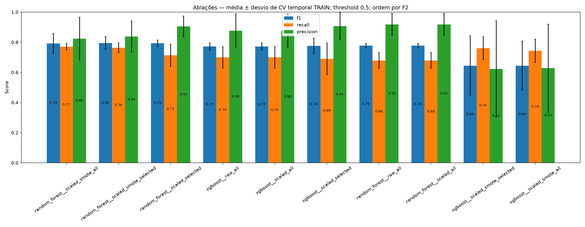
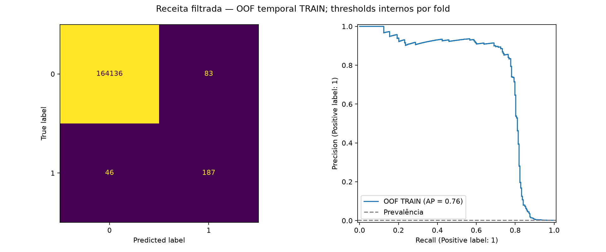

# StandardScaler, SMOTE e seleção conjunta de features

CV temporal somente TRAIN, mesmos três folds para dez receitas. A tabela principal usa threshold fixo 0,5 para separar mudanças de preprocessing do ajuste de threshold. RF sem SMOTE usa balanced_subsample; com SMOTE usa pesos uniformes. Essa mudança faz parte da receita.

| Receita | F2 | Recall (%) | Precision (%) | F1 (%) | AP |
|---|---:|---:|---:|---:|---:|
| random_forest__scaled_smote_all | 0.7783 | 77.11 | 82.38 | 79.20 | 0.7603 |
| random_forest__scaled_smote_selected | 0.7751 | 76.31 | 83.74 | 79.55 | 0.7557 |
| random_forest__scaled_selected | 0.7420 | 71.23 | 90.55 | 79.32 | 0.7590 |
| xgboost__raw_all | 0.7258 | 69.96 | 87.67 | 77.19 | 0.7689 |
| xgboost__scaled_all | 0.7258 | 69.96 | 87.67 | 77.19 | 0.7689 |
| xgboost__scaled_selected | 0.7211 | 69.00 | 90.68 | 77.64 | 0.7684 |
| random_forest__raw_all | 0.7151 | 67.93 | 91.80 | 77.78 | 0.7580 |
| random_forest__scaled_all | 0.7151 | 67.93 | 91.80 | 77.78 | 0.7581 |
| xgboost__scaled_smote_selected | 0.6933 | 76.00 | 62.23 | 64.42 | 0.7646 |
| xgboost__scaled_smote_all | 0.6868 | 74.37 | 62.80 | 64.41 | 0.7571 |

Melhor receita geral por F2: **random_forest__scaled_smote_all**.
Receita com retirada de features solicitada: **random_forest__scaled_smote_selected**.

**Retirar somente se |Pearson| < 0,090 E queda de AP por permutação < 0,100.** Correlação negativa forte é preservada. Os cortes não são porcentagens. Importâncias são recalculadas por referência XGBoost dentro de cada treino.

Mantidas no refit final: V1, V2, V3, V4, V5, V7, V9, V10, V11, V12, V14, V16, V17, V18.
Retiradas no refit final: Time, V6, V8, V13, V15, V19, V20, V21, V22, V23, V24, V25, V26, V27, V28, Amount.

## Threshold e erros por faixa

Threshold final por GridSearchCV/F2 no TRAIN: **0.7**.

| Política da receita filtrada | Recall (%) | Precision (%) | F2 |
|---|---:|---:|---:|
| fixed_0.5 | 76.31 | 83.74 | 0.7751 |
| gridsearch_f2 | 79.41 | 72.24 | 0.7741 |

Thresholds são ajustados internamente por fold; scores acima avaliam a política, não o threshold final isoladamente. Seleção da receita usou os mesmos folds: estes resultados são condicionados à seleção e podem ser otimistas.

A base não tem features categóricas; SMOTE foi aplicado às numéricas padronizadas. SMOTENC é para entradas mistas numéricas/categóricas, não porque o target é uma classe. SMOTE não é garantidamente melhor. A razão minoritária/majoritária pesquisada aqui é fixa em 0,1, mantendo todas as legítimas; não houve undersampling nesta rodada.

Os nomes raw_all, scaled_all, scaled_smote_all, scaled_selected e scaled_smote_selected significam, respectivamente: todas sem scaling; todas com StandardScaler; todas com StandardScaler+SMOTE; regra conjunta+scaling; regra conjunta+scaling+SMOTE.

Taxas de fraude observada por faixa: reports/metrics/eda_feature_bins.csv. Erros do modelo por faixa e fold: reports/metrics/category_error_metrics.csv. Cada percentual tem seu denominador explicado em docs/metrics_guide.md. As faixas são segmentos de features numéricas, não categorias de fraude reais.

**TEST não foi reavaliado.** Novo artefato local: models/standardized_selected_pipeline.joblib. Mais períodos independentes são necessários para validar o resultado; não houve calibração nem custo financeiro definido.

