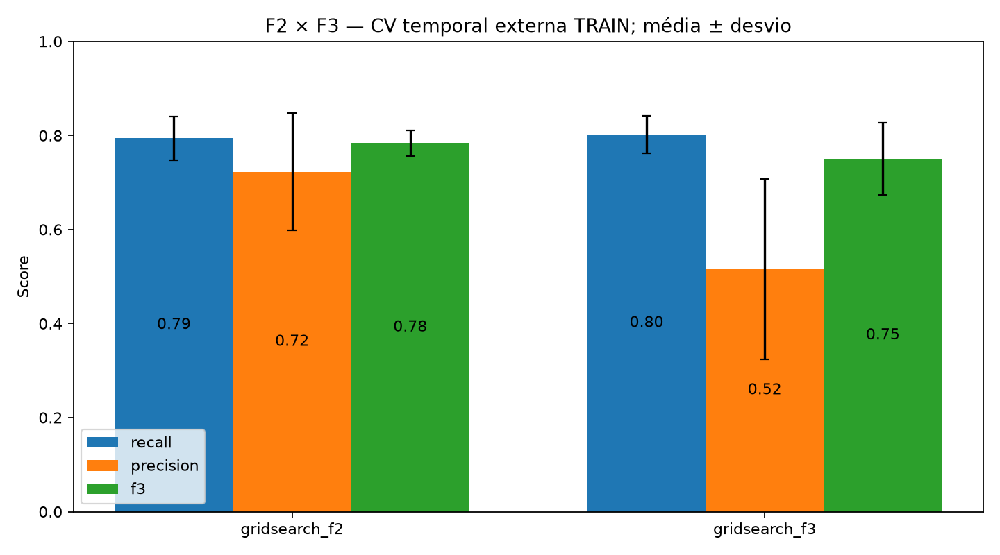

# F3 na seleção de threshold — somente TRAIN

Receita fixa: random_forest__scaled_smote_selected. Threshold final F2: 0.7; threshold final F3: **0.5**.

A mesma grade GridSearchCV foi resumida por F3 = 10TP/(10TP+9FN+FP). Isso equivale ao scorer F-beta com beta=3 sobre as mesmas previsões internas. Não houve seleção de features nem threshold no TEST.

| Política | Recall médio | Precision média | F2 médio | F3 médio | FP médios/fold | FN médios/fold |
|---|---:|---:|---:|---:|---:|---:|
| gridsearch_f2 | 79.41% | 72.24% | 0.7741 | 0.7836 | 27.7 | 15.3 |
| gridsearch_f3 | 80.20% | 51.61% | 0.7075 | 0.7499 | 58.3 | 14.7 |

Na CV externa, o Recall mudou em +0.79 p.p.
A Precision mudou em -20.63 p.p.
F3 não melhorou nem seu próprio score externo nesta rodada. O pequeno ganho de Recall veio com mais falsos alertas; a variante não deve ser descrita como superior ao F2.

Cada fold escolhe seu threshold em janela interna anterior à validação externa. O threshold final é escolhido novamente na janela interna do TRAIN completo. A família e receita foram escolhidas anteriormente com os mesmos dados: a estimativa é condicionada àquela seleção.

O modelo treinado não mudou no artefato final; só o threshold foi atualizado. Novo arquivo local: models/recall_f3_pipeline.joblib.

**TEST não foi reavaliado.** O notebook 04 continua descrevendo o pipeline F2 com threshold 0,70. F3 foi escolhido após esse resultado e precisa de outro período externo para confirmação independente.

