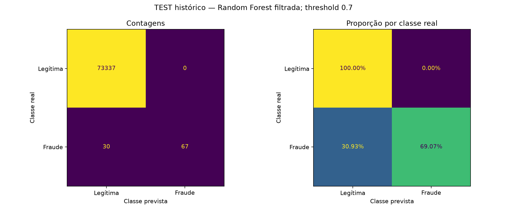
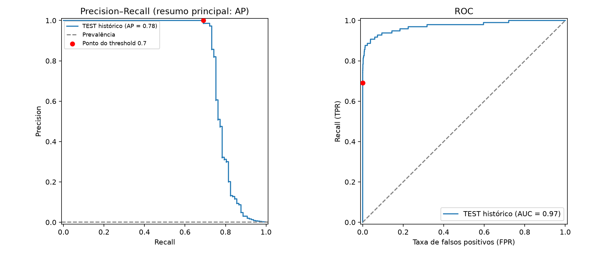

# TEST histórico — pipeline final filtrado

Receita: **random_forest__scaled_smote_selected**. Threshold congelado: **0.7**. Features: **14**.

**Reavaliação retrospectiva:** esse período já foi visto na primeira rodada. O modelo foi avaliado sem refit, seleção de features ou ajuste de threshold.

Transações: 73434; fraudes: 97; legítimas: 73337.

| Recall | Precision | F1 | F2 | AP | ROC-AUC |
|---:|---:|---:|---:|---:|---:|
| 69.07% | 100.00% | 81.71% | 73.63% | 0.7843 | 0.9734 |

| TN | FP | FN | TP |
|---:|---:|---:|---:|
| 73337 | 0 | 30 | 67 |

Definições, unidades e todas as métricas: reports/metrics/final_test_metric_definitions.csv. Notebook dedicado: notebooks/04_final_test_metrics.ipynb.

Não há evidência de generalização prospectiva, calibração ou custo ótimo. É necessário um período externo novo para avaliação independente após as iterações.
