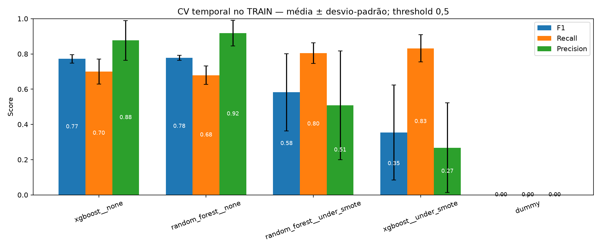
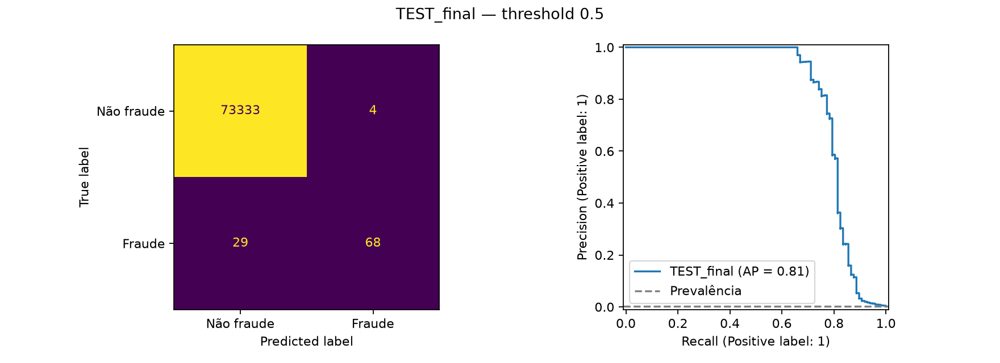

# Resultados da reformulação

Resultados calculados com o protocolo de configs/experiment.yaml. Não comparar diretamente com os números históricos com leakage.

TRAIN: 210,292 transações, 376 fraudes. TEST: 73,434 transações, 97 fraudes. Cópias exatas removidas: 1081.

## Seleção — CV temporal somente no TRAIN

Classe positiva: fraude (1). Threshold 0,5, três janelas expansivas. Valores: média ± desvio-padrão entre folds. Ordenação por AP.

| Receita | AP | F1 | Recall | Precision |
|---|---:|---:|---:|---:|
| xgboost__none | 0.7689 ± 0.0208 | 0.7719 ± 0.0234 | 0.6996 ± 0.0709 | 0.8767 ± 0.1123 |
| random_forest__none | 0.7580 ± 0.0325 | 0.7778 ± 0.0147 | 0.6793 ± 0.0524 | 0.9180 ± 0.0728 |
| random_forest__under_smote | 0.7513 ± 0.0354 | 0.5822 ± 0.2190 | 0.8040 ± 0.0588 | 0.5087 ± 0.3088 |
| xgboost__under_smote | 0.7387 ± 0.0084 | 0.3540 ± 0.2694 | 0.8319 ± 0.0778 | 0.2676 ± 0.2546 |
| dummy | 0.0014 ± 0.0006 | 0.0000 ± 0.0000 | 0.0000 ± 0.0000 | 0.0000 ± 0.0000 |

Selecionado: **xgboost__none** pela AP média de CV. A diferença para Random Forest sem reamostragem é pequena em relação à dispersão entre folds; não foi demonstrada superioridade estatística.

Nesta rodada, under+SMOTE aumentou Recall médio, mas reduziu Precision e F1 e não superou a melhor AP sem reamostragem. O balanceamento não é obrigatório para estes dados/modelos. RF sem reamostragem usa pesos de classe, de modo que esta é uma comparação entre receitas completas.

## Avaliação final — TEST temporal, somente o vencedor

Receita congelada: **xgboost__none**. Threshold **0.5**.

| AP | F1 | Recall | Precision | ROC-AUC |
|---:|---:|---:|---:|---:|
| 0.8062 | 0.8047 | 0.7010 | 0.9444 | 0.9871 |

| TN | FP | FN | TP |
|---:|---:|---:|---:|
| 73333 | 4 | 29 | 68 |

Foram detectadas 68 de 97 fraudes. As 29 fraudes não detectadas mostram que alta Precision não equivale a capturar todas as fraudes.

## Limitações

A base tem só dois dias e já foi explorada no projeto antigo. O resultado é retrospectivo, não prospectivo. Não há intervalos formais de incerteza nem custos de erro informados; probabilidades não foram calibradas. PCA original e independência por cartão não são auditáveis. Desvio entre folds não é intervalo de confiança do TEST. Não há prontidão de produção demonstrada.

Detalhes: ../docs/methodology.md. Recrie este resumo com python scripts/summarize_results.py após gerar os artefatos.
