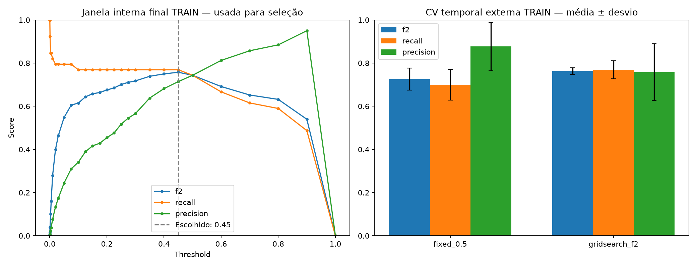

# GridSearch de threshold com ênfase em Recall

Receita fixa: xgboost__none. Melhor threshold F2 na grade: **0.45**. Foram pesquisados 29 limiares.

F2 (beta=2) prioriza Recall, mas penaliza falsos positivos. GridSearchCV varia threshold no FixedThresholdClassifier; FrozenEstimator preserva o modelo ajustado no prefixo, sem treinar na janela que escolhe o limiar.

## Avaliação da política — CV temporal externa somente TRAIN

| Política | F2 média | Recall médio | Precision média | FP médios/fold | FN médios/fold |
|---|---:|---:|---:|---:|---:|
| fixed_0.5 | 0.7258 | 0.6996 | 0.8767 | 7.7 | 23.3 |
| gridsearch_f2 | 0.7634 | 0.7695 | 0.7586 | 20.3 | 17.7 |

Cada fold escolhe seu threshold numa janela interna anterior à validação externa. O limiar final é escolhido novamente na janela interna do TRAIN completo; seu score de seleção não é avaliação independente.

A receita já foi selecionada por AP na rodada anterior; a avaliação aqui é condicionada a essa escolha. Não é uma nova avaliação independente de toda a seleção.

## Recall puro — referência, não política adotada

Na janela interna final, maximizar só Recall escolheria threshold 0.0003, Recall 1.0000, Precision 0.0033 e 11826 alertas.

## Artefato e limites

Novo artefato local: models/recall_pipeline.joblib, com refit no TRAIN completo. O pipeline anterior e os resultados históricos de TEST não foram alterados. **TEST não foi avaliado novamente.** É necessário outro período externo para avaliar esta nova política de forma independente. Melhor na grade não significa ótimo universal, custo ótimo ou probabilidade calibrada.
